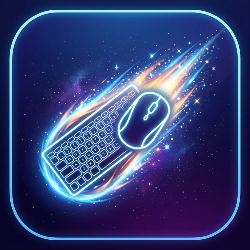

<p align="center">
  
</p>

# CometBar

A macOS menu bar app for switching your **GL.iNet Comet X** KVM between
machines — no web console, no reaching for another keyboard.

## What it does

- **Switch inputs from the menu bar.** Click the icon, pick a machine. Done.
- **Global keyboard shortcuts.** `⌘⌥1` – `⌘⌥4` switch ports from anywhere,
  no need to open the menu first.
- **See what's live before you switch.** Each port shows whether its monitor
  and keyboard/mouse are actually connected, refreshed automatically.
- **Name your ports.** Call them "Work MBP", "Personal Mini" — whatever makes
  sense to you. Names live on the KVM itself (shared with its web UI), so
  they show up the same way on every Mac you run CometBar on.
- **Stay awake while docked.** Optional: closing your laptop lid normally
  puts it to sleep, which is a problem when the KVM has switched away and
  taken your only display with it. CometBar can keep your Mac awake while
  it's docked and switch back to normal sleep the moment it's undocked —
  installed with one click, no Terminal required.
- **Works with your specific dock.** Point CometBar at whichever dock or hub
  you use to tell it when you're "at your desk" — it doesn't assume one
  particular brand.
- **Fix "everything's too small."** The KVM's virtual display often starts
  at a resolution that makes text tiny. "Change Resolution…" in the menu
  jumps straight to System Settings' scaled-resolution picker for it.

## Install

1. Download `CometBar.zip` from the [latest release](../../releases/latest),
   unzip it, and drag `CometBar.app` to **Applications**.
2. Open it. Since it isn't notarized by Apple, the first launch needs a
   right-click → **Open** (plain double-click will be blocked by Gatekeeper).
3. Click the new menu bar icon → **Settings…** and fill in:
   - Your Comet X's address (usually `glkvm.local`) and admin password.
   - A friendly name for each port, if you'd like.
4. That's it — the menu bar icon shows your active port, and switching is
   one click (or `⌘⌥1`–`⌘⌥4`) away.

## Using it

**Switching ports** — click the menu bar icon and pick a machine, or use
`⌘⌥1` through `⌘⌥4` from anywhere. One thing worth knowing: switching moves
your keyboard and mouse along with the display, so a shortcut can only ever
switch *away* from the Mac you're pressing it on — to switch back, use
CometBar on whichever machine you land on (or the KVM's own controls).

**Staying awake while docked** — open Settings → Clamshell and click
**Install background helper…**. macOS will ask for your admin password once;
after that, turn the feature on and CometBar keeps your Mac awake whenever
it's docked, and lets it sleep normally otherwise. It only manages sleep
while switched on — nothing changes until you flip it on.

**Setting up your dock** — Settings → Dock lists your currently-connected
USB devices by name. Pick whichever one is your dock (or hub) so CometBar
knows when you're "at your desk." This is per-machine, since different Macs
and different docks show up differently.

**Moving to another Mac** — install CometBar there too. Your port names come
along automatically (they live on the KVM), but you'll need to enter that
machine's Comet X password and pick its dock once — those live on the Mac,
not the network.

## Development

This is a Swift Package Manager project — `Sources/CometKit` holds the
reusable core (API client, settings, device watchers), `Sources/CometBar` is
the menu bar app, and `Sources/comet-cli` is a CLI for testing against the
device without building the full app.

```sh
swift build && swift test   # build + unit tests
swift run comet-cli status  # quick check against the live device
make app && make install    # assemble and install CometBar.app
```

**[CLAUDE.md](CLAUDE.md)** has the full technical reference — verified API
quirks, the clamshell daemon's architecture, and a few traps that cost real
debugging time the first time around. Worth a read before touching the
Comet X integration code.
